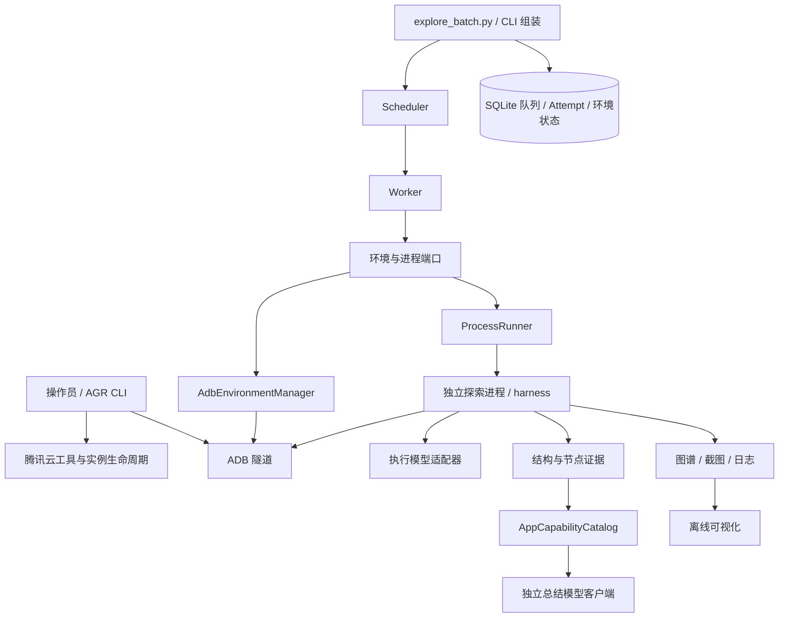

# 云端 sandbox 架构与整理决策

状态：已采用。范围：单机调度多个独立 App 任务，以云端 Android World 实例作为设备。使用模块化单体及 Ports & Adapters，保持现有探索算法，避免为单机引入额外消息队列或微服务。

## 边界与依赖

- `orchestration/models.py` / `errors.py` 定义纯任务、结果及校验规则。
- `ports.py` 定义 Worker、调度器所需接口；核心通过接口协作，不导入 harness 或模型 SDK。
- `store.py`、`environments.py`、`process_runner.py`、`locks.py` 是 SQLite、ADB、操作系统的适配器；`cli.py` 负责组装。
- Worker 线程监督独立探索进程；一个 Attempt 独占一台设备和独立输出目录。数据库事务、唯一索引与进程锁维护任务、设备和资源键的互斥。
- `harness` 负责 App 生命周期、页面/状态身份、动作、恢复、验证与证据；它不创建 Android 虚拟机。

云工具模板、云实例、ADB 连接和目标 App 是四个不同概念。队列中的 environment 表示当前连接的设备 serial，不是云工具或实例。`available` 仅是调度器持久化的可分配状态，不代表远端当前仍存活；执行前必须检查连接。

当前实例创建、销毁及隧道连接仍由 AGR 操作，环境管理器只检查 Android 就绪、App 安装状态、执行 force-stop 或显式的 clear-data。`harness/lifecycle.py` 管理 App 的启动、退出与重放，云设备同样需要，因此保留。

重新连接可能得到新端口。为新批次使用新的队列数据库并登记当前 serial，避免复用旧队列中已失效的设备记录。未来若接入自动生命周期，需要以稳定 InstanceId 管理资源，再绑定临时 serial；不把云 API 调用塞进探索循环。

## 目录和产物约定

- 根目录仅保留用户入口及依赖、配置样例；详细说明统一放 `docs/`，任务清单放 `examples/`，测试放 `tests/`。
- 下载的 AGR / ADB 移到 `.tools/`；Python 环境保留 `.venv/`。工具与产物不再混放，二者均忽略提交。
- 删除已解压的 platform-tools 安装压缩包、一次性凭据配置脚本、缓存截图探针及重复文档、单次连接/模型探测截图和响应。
- App 清单迁入 `output/glm-smoke-20261020/device-inventory/`。该批次的成功图谱、查看器、释放记录、全部诊断数据库及运行证据保留原路径，便于排查 Draw 状态恢复阻塞。
- `.env` 和用户目录下 AGR 凭据保持原样。配置示例采用通用 `MODEL_*`，既有 `QWEN_*` 继续兼容。清理过程不启动云实例或调用模型。

## 验证范围与后续边界

离线测试覆盖任务并发、互斥、取消、超时、重试、隔离、进程锁，以及模型请求适配、功能目录生成、节点变体、合成数据、上下文预算和可视化导出。真实云端联调的证据保留，但本次重构没有重新进行付费联调。

当前仍是单机持久化队列，无 Docker、多机或全局 RPM/TPM 限流。三步联调成功不代表完整功能覆盖；Draw 长程探索的状态恢复阻塞仍待独立修复。
