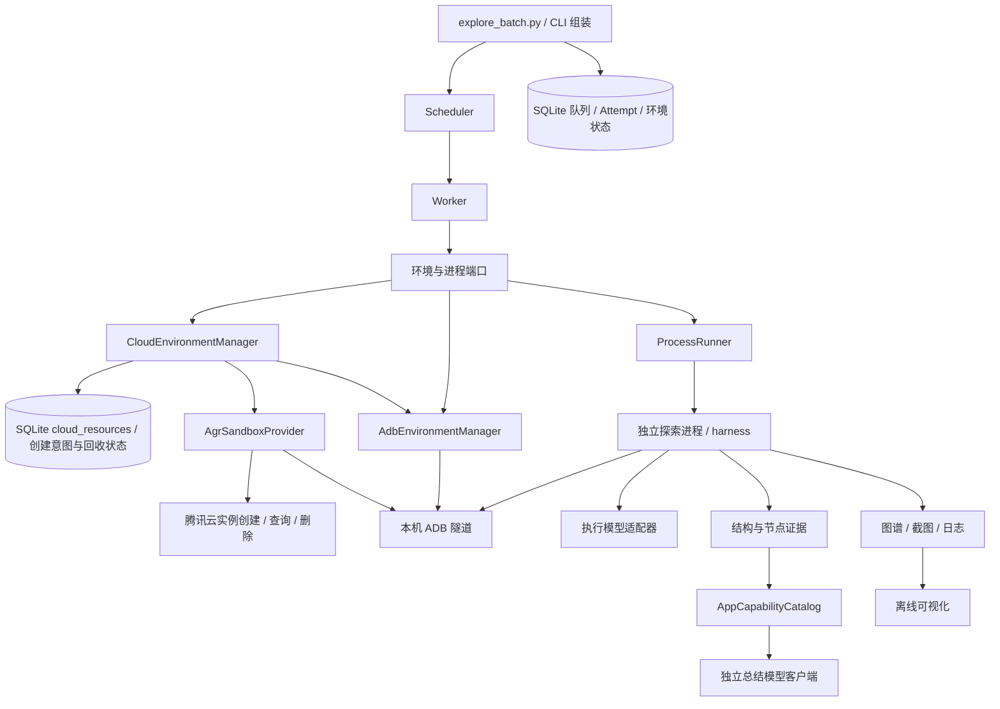
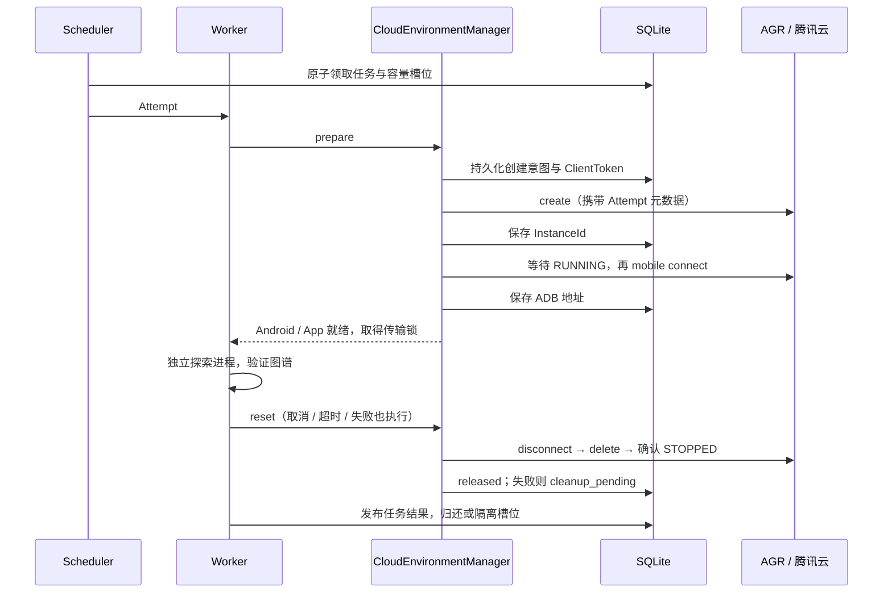

# 云端 sandbox 架构与整理决策

状态：已采用。范围：单机调度多个独立 App 任务，以云端 Android World 实例作为设备。使用模块化单体及 Ports & Adapters，保持现有探索算法，避免为单机引入额外消息队列或微服务。

## 边界与依赖

- `orchestration/models.py` / `errors.py` 定义纯任务、结果及校验规则。
- `ports.py` 定义 Worker、调度器所需接口；核心通过接口协作，不导入 harness 或模型 SDK。
- `cloud_environments.py` 编排云资源生命周期，依赖 `SandboxProvider`、`CloudResourceRepository` 端口；`agr.py` 是腾讯云 AGR 适配器。云端接口不进入 harness 探索循环。
- `store.py`、`environments.py`、`process_runner.py`、`locks.py` 是 SQLite、ADB、操作系统的适配器；`cli.py` 负责组装。
- Worker 线程监督独立探索进程；一个 Attempt 独占一台设备和独立输出目录。数据库事务、唯一索引与进程锁维护任务、设备和资源键的互斥。
- `harness` 负责 App 生命周期、页面/状态身份、动作、恢复、验证与证据；它不创建 Android 虚拟机。

云工具模板、云实例、ADB 连接和目标 App 是四个不同概念。托管 environment 是稳定的 `cloud:<uuid>` 容量槽位；`cloud_resources` 按 Attempt 保存工具、地域、创建幂等键、实例 ID、ADB 地址及回收状态。ADB 地址可以变化，不再用它替代云资源身份。外部设备模式仍以 serial 登记，调度器按 provider 隔离选择。

## 云实例生命周期

容量槽位只提供并发许可，空队列不创建实例。创建、探索与回收均计入 `--concurrency`，每个 Attempt 使用全新实例；完成后销毁，不复用登录状态或设备数据。云 API 和 ADB 调用都在短数据库事务之外。应用生命周期仍由 `harness/lifecycle.py` 管理。

创建响应丢失时，启动巡检按工具和 Attempt 元数据找回实例；不会在回收中盲目重放创建。如果尚不能唯一确认结果，保留欠账、隔离槽位，并由 `env cleanup` 重试。重启先标记旧 Attempt 为 `lost`，再回收已知资源；仍存活且持有继承锁的探索进程会阻止回收。逻辑槽位锁和本次 ADB 传输锁均传给子进程。

回收拥有独立超时，不受任务取消标记或原预算过期影响。先断开该实例的隧道，再停止云实例并查询终态；隧道断开失败仍尝试停止云实例。两者任一失败都会保留 `cleanup_pending`，不会报告资源已全部释放。只管理本队列记录的实例，不扫描并删除其他任务的资源，也不使用全局 disconnect。

## 目录和产物约定

- 根目录仅保留用户入口及依赖、配置样例；详细说明统一放 `docs/`，任务清单放 `examples/`，测试放 `tests/`。
- 下载的 AGR / ADB 移到 `.tools/`；Python 环境保留 `.venv/`。工具与产物不再混放，二者均忽略提交。
- 删除已解压的 platform-tools 安装压缩包、一次性凭据配置脚本、缓存截图探针及重复文档、单次连接/模型探测截图和响应。
- App 清单迁入 `output/glm-smoke-20261020/device-inventory/`。该批次的成功图谱、查看器、释放记录、全部诊断数据库及运行证据保留原路径，便于排查 Draw 状态恢复阻塞。
- `.env` 和用户目录下 AGR 凭据保持原样。配置示例采用通用 `MODEL_*`，既有 `QWEN_*` 继续兼容。清理过程不启动云实例或调用模型。

## 验证范围与后续边界

离线测试覆盖任务并发、互斥、取消、超时、重试、隔离、进程锁，以及模型请求适配、功能目录生成、节点变体、合成数据、上下文预算和可视化导出。云生命周期测试覆盖部分创建/连接失败、响应丢失、回收欠账、原地 schema 迁移和重启巡检。

2026-10-21 真实联调完成两轮 Tasks / Markor 并发探索，每任务一动作；第二轮完整自动创建、连接、探索并回收，退出码 0、资源欠账 0。两轮共四个实例全部确认 STOPPED，无遗留隧道；证据位于 `output/managed-cloud-smoke-20261021/verification.json`。首轮暴露的 AGR 0.7.0 兼容问题已在适配器修复并回收。该测试验证生命周期闭环，不代表 App 功能的完整覆盖。

当前仍是单机持久化队列，无 Docker、多机或全局 RPM/TPM 限流。三步联调成功不代表完整功能覆盖；Draw 长程探索的状态恢复阻塞仍待独立修复。
